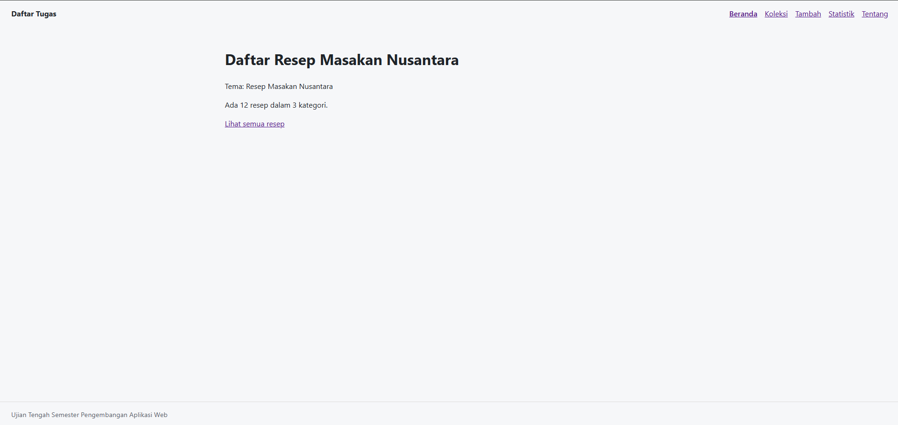

# Nama Aplikasi

Nama: Muhammad Aditya Dhani Putra
NIM: 124140041
Kelas: RA
Tema: Resep Masakan Nusantara
Deployment: https://Adyoras.github.io/uts-paw/

## Fitur

- Tombol di header untuk pindah halaman 
- Beranda menampilkan tema, jumlah resep dan kategori yang ada. Tombol untuk ke Koleksi
- Koleksi menampilkan semua resep yang tersedia. Fitur search bar yang memudahkan pengguna untuk langsung mencari resep yang tersedia tanpa harus mencari 1 per 1. Fitur opsi untuk memfilter resep sesuai kategori tingkat kesulitan. User dapat menekan judul resep yang tersedia untuk menghapus resep.
- Halaman Tambah untuk menambahkan resep ke dalam halaman Koleksi. User dapat menambahkan judul resep, memilih kategori, menentukan daerah asalnya, berapa lama waktu memasak (dalam menit), dan memilih tingkat kesulitannya. Ketik tombol "Simpan" untuk menyimpannya di halaman Koleksi.
- Statistik berfungsi untuk melihat total jumlah resep yang ada  di dalam semua kategori.
- Tentang untuk melihat identitas pembuat.

## Menjalankan secara lokal

cd app
npm install
npm run dev

## Konsep React yang dipakai

- ...